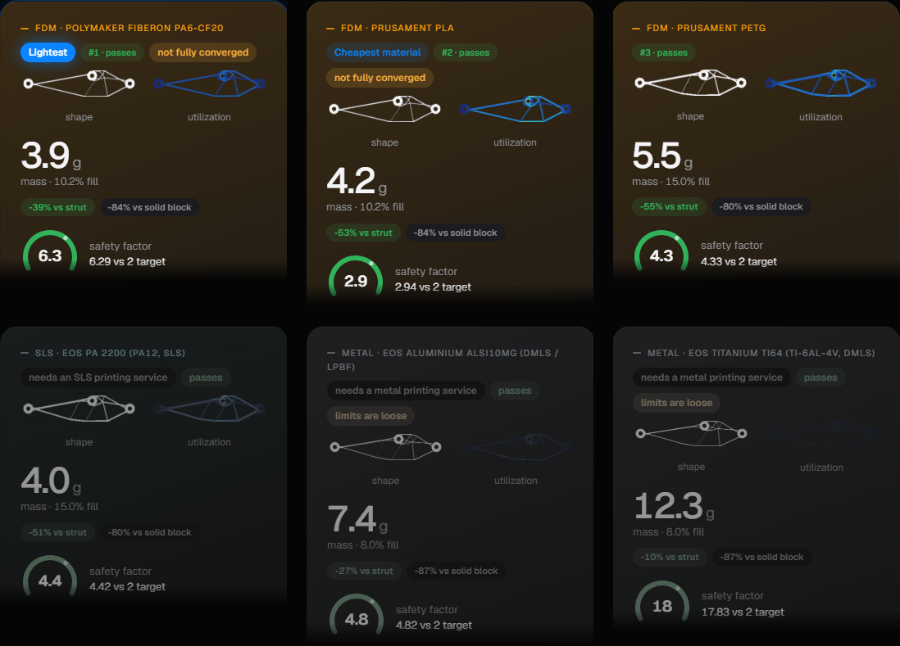

# Morphic: plain English, cited materials, checked and reproducible design

*OSI Hackathon, October 21 to 22, 2026. Solo entry. Open source (MIT).*

**Problem.** Shape and material must be chosen together: the lightest shape depends on the limits, the material and the process minimum wall. Tools hide that coupling and rarely cite material numbers.

**What Morphic does.** Plain English, cited materials, checked and reproducible design: describe the part, check it on a drawing, and Morphic optimizes a shape for six cited materials across FDM, SLS and metal, ranks passing designs by mass, explains the winner with verified numbers, and exports STL, SVG, DXF, a PDF report and a run bundle that reruns to the same answer.

**Method.** Our SIMP optimizer finds per material the lowest passing fill level among stiffness-optimized shapes: compliance is minimized at each fill level, and the lowest level meeting the safety factor and deflection limit in every load case is picked and refined by bisection. One catalog per process, filtered to its minimum wall, serves every material (deflection scales with 1/E; stress is independent of E). The exported shape is smoothed and re-checked, so card numbers match the STL. The update rule adds material where strain energy is high and removes it where it is low, the principle of bone remodeling (Wolff; Huiskes et al. 2000).

**Key result.** RC car arm, 90 × 20 × 12 mm, three load cases, safety factor 2, desktop FDM: PA6-CF wins at 3.93 g and 10 % fill, 39 % lighter than a strut design sized by the same solver to the same limits (6.40 g), 84 % lighter than the solid block. 84 candidates, 6 met the limits, 3 fit the printer; PLA 4.17 g, PETG 5.45 g; SLS and metal designs greyed as needing a service.

**Validation.** Same solver as the designs; 201 tests pass.

| Check | Mesh | Result |
|---|---|---|
| Cantilever vs beam theory | 200 × 20, h 0.5 mm | deflection 0.31 %, recovered stress 0.37 %, element-centre 0.12 % (limit 3 %) |
| Mesh refinement, deflection | 2 to 32 elements deep | 11.2 → 3.2 → 1.0 → 0.4 → 0.2 % |
| MBB benchmark | 60 × 20, paper mode | 233.71 vs 233.71 published, 144 iterations |
| Hole, K_t = 3.02 | 8 / 16 / 32 per radius | element-centre 15.7 / 10.2 / 5.6 %; recovered 6.0 / 1.2 / 2.3 % |
| Scaling, E doubled | fixed shape | deflection ratio 0.5000, stress ratio 1.0000, errors < 3e-13 |

**Breadth.**
- Hobby, RC car arm: PA6-CF, 3.93 g, 39 % lighter than the strut.
- UAV, FPV drone arm: PA6-CF, 13.3 g, 39 % lighter than the strut; PLA and PETG fail the 0.5 mm deflection limit; the agent's taller section (120 × 22.5 mm) passes at full resolution at 10.49 g (safety factor 10.5, worst deflection 0.46 mm), qualified not converged: its optimization stopped early and the independent cold rerun did not pass.
- Aerospace, GE bracket challenge, 2D slice: AlSi10Mg, 111 g, 55 % lighter than the strut; Ti-6Al-4V 174 g; every polymer fails on bearing and stress; the 25 mm slice carries the full load, so stresses are several times the real bracket's and not comparable to the 3D results.

**Limits.** Static, 2D plane stress, extruded thickness; no fatigue, impact, buckling or physical test. Von Mises with one strength simplifies plastics; PA6-CF is anisotropic within a layer (XY value along the bead; perimeters assumed along the members). Corner stress is mesh-dependent: nodal recovery is used, and the remaining edge error at the live mesh (6.0 % at 8 per radius) is stated on every card. Printed flat, 100 % infill.

**Relation to existing tools.** Fusion 360 generative design and nTopology also compare materials and processes; Morphic is open, cited, checked and reproducible, and adds a material at near-zero cost.

**Impact and next steps.** Checksummed run bundles reproduce a result (a strict RC arm replay matched 450 values exactly). MIT. Next: 3D, fatigue, physical tests, broader bio-inspired rules.

**Citations.** Prusament PLA/PETG TDS v1.1 · Polymaker PA6-CF20 TDS v1.1 · EOS PA 2200, AlSi10Mg, Ti64 data sheets · Protolabs min-wall guides · Andreassen et al. 2011 · Bendsøe & Sigmund 2003 · Wolff 1892; Huiskes et al. 2000 · Pilkey, Peterson's SCF Chart 4.1 · GE/GrabCAD Bracket Challenge 2013 · FAR 25.303
